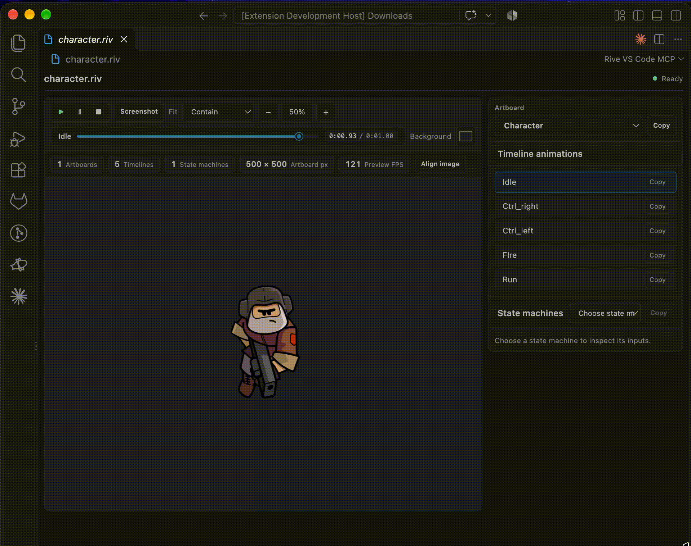

# Rive VS Code MCP

Preview and inspect Rive `.riv` files without leaving Visual Studio Code.



## Features

- Preview Rive artboards with timeline animations and state machines.
- Select artboards and animations, play or pause playback, and scrub timelines.
- Inspect state-machine inputs and interact with supported inputs.
- Adjust fit, zoom, and preview background.
- Align an artboard over a temporary background image and copy its top-left `x`/`y` coordinates and scale.
- Optionally inspect Rive file metadata through the `inspect_rive_file` MCP tool.

## Use the preview

1. Install **Rive VS Code MCP** from the Visual Studio Code Marketplace.
2. Open a `.riv` file. If prompted, choose **Rive VS Code MCP** as its editor.
3. Use the side panel to choose an artboard or inspect animations and state machines.
4. Use the preview toolbar for playback, timeline scrubbing, fit, zoom, background color and opacity, and screenshot export.


## MCP server in VS Code

The extension contributes one local stdio MCP server, discovered automatically by VS Code across workspaces. Use **MCP: List Servers** to manage **Rive MCP**. The `inspect_rive_file` tool returns artboard dimensions, animation names and timing, state-machine names, and input names and types.


### Enable in Cursor or another MCP client

1. Run **Rive VS Code MCP: Copy Global MCP Configuration** from the Command Palette once.
2. Paste the copied `rive-vscode-mcp` entry into your MCP client's user-level/global configuration. For Cursor, use `~/.cursor/mcp.json`. This works across projects under your home directory.


## Requirements

- Visual Studio Code 1.101 or later.
- Node.js 18 or later to run the MCP server from another client outside VS Code.

## Development

```bash
npm install
npm run compile
"/Applications/Visual Studio Code.app/Contents/Resources/app/bin/code" --new-window --extensionDevelopmentPath="$PWD" "/absolute/path/to/sample.riv"
```

The compile command builds the preview stylesheet and TypeScript extension code.

## Automated VSIX releases

Each push to `main` runs the tests, compiles the extension, and publishes the VSIX as an asset on a GitHub Release tagged with that commit's SHA.

## License

[MIT](LICENSE)
